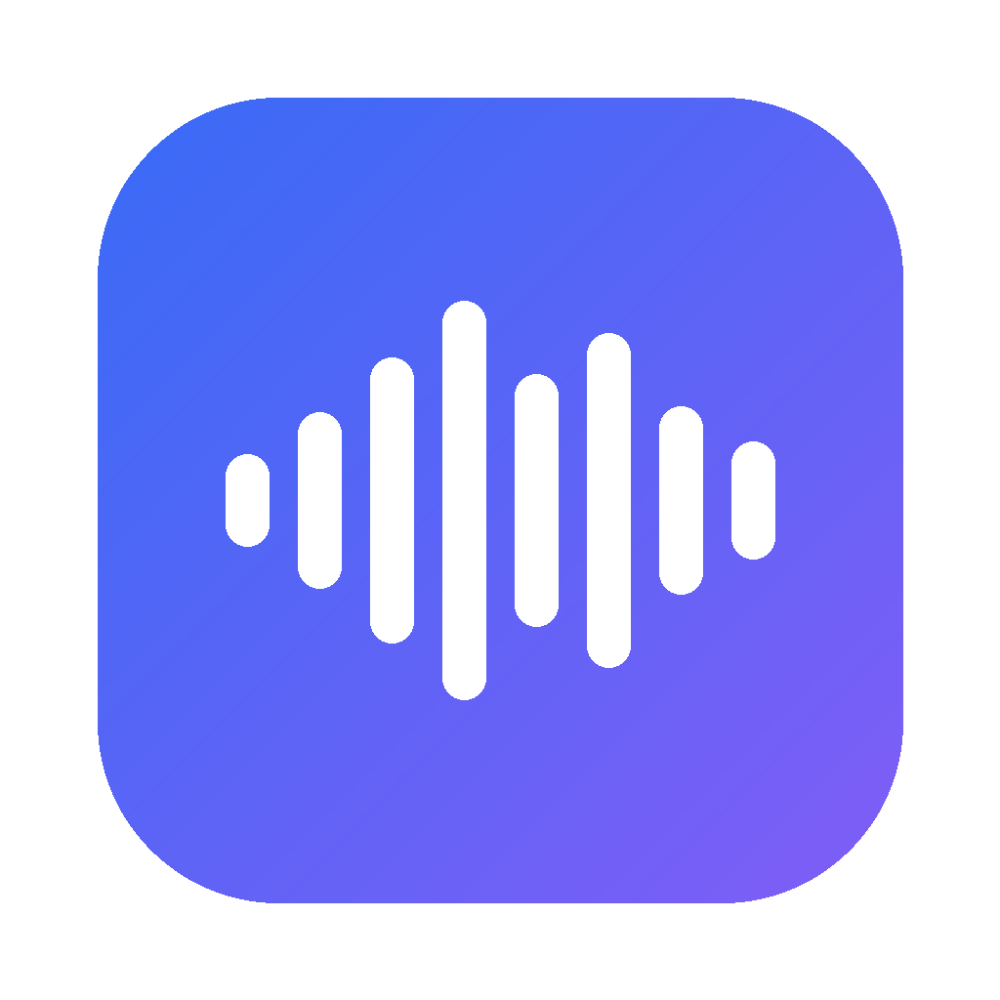

# Voice Enhancer

A macOS app that turns raw voice into clean, professional voiceover audio with the **exact same sound every time**.

- **Record** right in the app. When you stop, it saves your take and enhances it automatically.
- **Drop** audio or video files (or whole folders) onto the window.
- **Before / After** player on every result.
- Everything is saved to **one output folder you choose** (remembered between launches).



## Install (Mac, Apple Silicon)

Requires [Node.js](https://nodejs.org) 20+.

```bash
git clone https://github.com/Sharifur/AudioEnhancer.git
cd AudioEnhancer
npm install
npm run install-app      # builds "Voice Enhancer.app" and copies it to /Applications
```

Then open **Voice Enhancer** from Launchpad or Spotlight. The first time you record, macOS asks for microphone access: click **Allow**.

**Easiest:** double-click `Install Voice Enhancer.command` in Finder. It installs Node.js via Homebrew if needed, builds the app, copies it to Applications and opens it. Progress is saved to `install.log`.

To run without installing: `npm start`.

**Prefer not to build locally?** Open the repo's **Actions** tab → *Build macOS app* → *Run workflow*, then download the `Voice-Enhancer-mac-arm64` zip from the finished run. Unzip, drag the app to Applications, and right-click → **Open** the first time (it isn't signed with an Apple developer ID).

## Signed build with your Apple certificate

Double-click **Build Signed App.command** (or run `./scripts/build-signed-mac.sh`). It:

1. Finds your code-signing certificate in the keychain (prefers *Developer ID Application*, falls back to *Apple Development*).
2. Builds the app with the hardened runtime and microphone entitlement, signed with that certificate.
3. Notarizes it if you've saved a notary profile once:
   `xcrun notarytool store-credentials VoiceEnhancer --apple-id you@example.com --team-id TEAMID`
4. Verifies the signature, installs to `/Applications` and opens it. A signed `.dmg` for sharing lands in `dist/`.

macOS may ask whether `codesign` can use your key; click **Always Allow**. Output is logged to `build-signed.log`.

## The sound chain

Every file goes through the same fixed chain (bundled ffmpeg, so results don't depend on what's installed on your Mac):

| # | Step | Setting | Why |
|---|---|---|---|
| 1 | High-pass | 80 Hz | Removes rumble and handling noise |
| 2 | AI noise removal (RNNoise) | 90% mix | Removes hiss, fans, room noise |
| 3 | FFT denoise | light | Cleans leftover hiss |
| 4 | EQ | -2.5 dB @ 250 Hz | Removes boxy, muddy tone |
|   |    | +2.5 dB @ 3.2 kHz | Presence and clarity |
|   |    | +2 dB shelf @ 9 kHz | Air |
|   |    | +1.5 dB shelf @ 140 Hz | Warmth |
| 5 | De-esser | medium | Tames harsh "s" sounds |
| 6 | Compressor | 3:1, -22 dB | Evens out loud and soft words |
| 7 | Gentle gate | -42 dB | Keeps pauses clean |
| 8 | Limiter | -1 dB | Catches peaks |
| 9 | Two-pass loudness | -16 LUFS, -1.5 dBTP | Same loudness on every file |

Output per file: `name_pro.wav` (48 kHz, 24-bit) and `name_pro.mp3` (320k).

## Settings (bottom bar)

| Setting | Default | Notes |
|---|---|---|
| Noise removal | 90% | Lower to 70% if the voice sounds processed |
| Loudness | -16 LUFS | -14 for Reels/Shorts, -19 for a quieter broadcast level |
| Keep raw recordings | on | Raw takes go to `Raw recordings/` inside your output folder |
| Also save MP3 | on | |

Shortcut: **⌘R** starts or stops recording.

## Command-line version

`scripts/enhance.sh` runs the identical chain from Terminal (needs `brew install ffmpeg`):

```bash
./scripts/enhance.sh recording.wav            # one file
./scripts/enhance.sh ~/Desktop/takes -o out/  # a folder
```

## Project layout

```
src/engine.js        processing chain (pure Node, testable)
src/main.js          Electron main process: queue, recording to disk, settings
src/preload.js       safe bridge to the UI
src/renderer/        UI (HTML/CSS/JS) + mic capture worklet
resources/           RNNoise voice model
scripts/enhance.sh   command-line version
test/                engine test
```

Run the engine test on a folder of audio: `npm test -- <inputDir> <outDir>`.

## Tips for the best result

Record at 48 kHz with a wired or USB mic, close to your mouth, in a quiet room. The app can clean noise, but it can't add detail the mic never captured.
